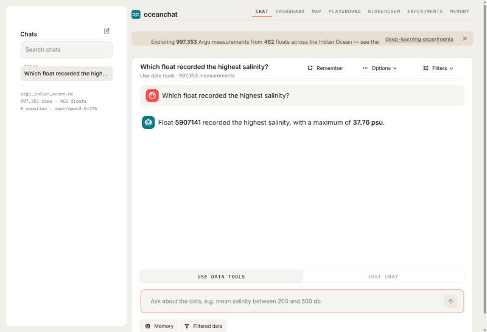
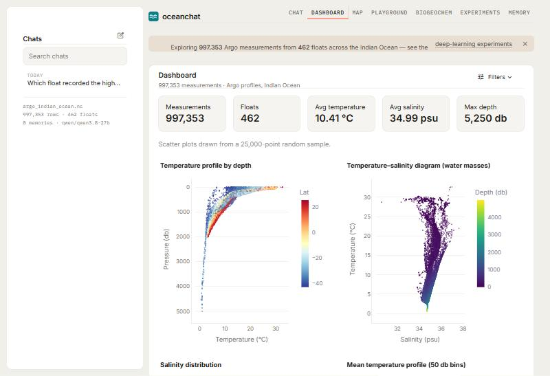
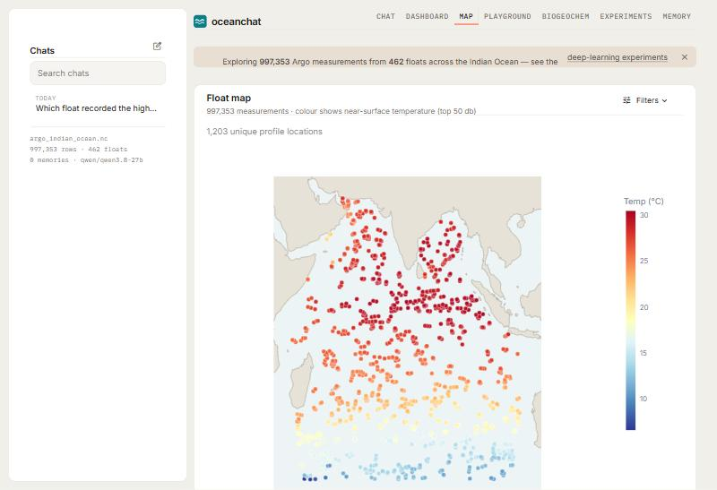
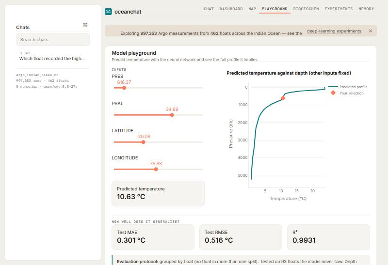
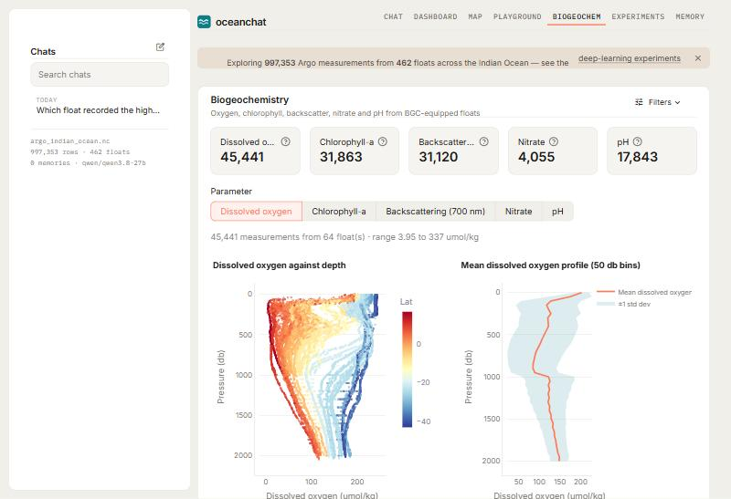
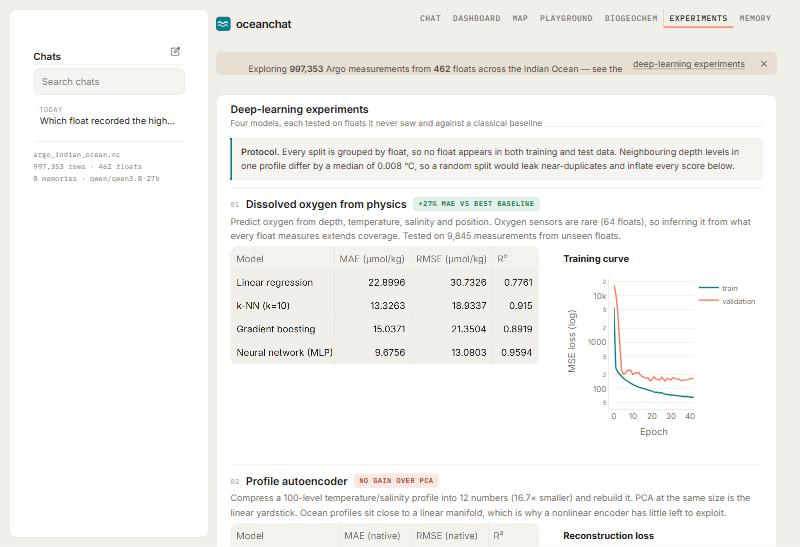

# OceanChat

A Streamlit application for exploring Argo float measurements from the Indian Ocean, with
a natural-language agent that writes and runs pandas code against the loaded data, and a
suite of four deep-learning experiments evaluated under float-grouped splits.

Built on 997,353 quality-controlled measurements from 462 floats.



---

## What it does

Seven pages behind one navigation bar. Only the active page renders on each rerun, so the
charts elsewhere cost nothing.

### Chat

Two modes share the same conversation. **Use data tools** gives an LLM agent a pandas
dataframe and lets it write and execute code, so answers carry real numbers; **Just chat**
is a plain conversation for concepts, with no code execution. The filters applied on the
data pages also decide what the agent sees. Conversations persist across restarts, and a
long-term memory store is injected into the agent's prompt.

### Dashboard



Summary metrics, a temperature-by-depth scatter coloured by latitude, a
temperature-salinity diagram for identifying water masses, a salinity histogram, and a
mean temperature profile in 50 db bins with a plus/minus one standard deviation envelope.
Scatter plots draw from a 25,000-point sample to stay responsive; every number above them
is computed on the full selection. CSV export included.

### Map



All 1,203 unique profile locations, coloured by near-surface temperature. The warm
equatorial band and the cold Southern Ocean floats near -42 degrees are visible directly.

### Model playground



Predict temperature from pressure, salinity, latitude and longitude. The sliders are
generated from `models/model_meta.json`, so changing the feature list in `train_model.py`
updates the interface automatically. The chart holds the other inputs fixed and sweeps
depth, showing the whole profile the network implies.

### Biogeochemistry



Oxygen, chlorophyll-a, backscatter, nitrate and pH from the minority of floats carrying
those sensors. The oxygen profile shows the Arabian Sea oxygen minimum zone.

### Experiments



The four deep-learning tasks below, each with its learning curve, its classical baseline
and a verdict chip that is honest when the network does not win.

### Memory

Browse, add and delete the durable facts the assistant keeps between conversations.

---

## The evaluation protocol

This is the part of the project worth reading carefully.

Argo measurements are **not independent**. Each profile contributes roughly 790 rows, one
per depth level, and adjacent levels differ by a median of 0.008 degrees C. A random
`train_test_split` therefore scatters near-duplicate rows across train and test, and
measures memorisation rather than generalisation.

Every split in this repository is **grouped by float**, and `dl.data.split_report` asserts
that no float appears in two splits. The cost of getting this wrong, measured on the
temperature model by `audit.py`:

| Split | MAE (deg C) | R-squared |
|---|---|---|
| Random - leaky | 0.202 | 0.9971 |
| Grouped by float - honest | **0.302** | **0.9931** |

A third of the apparent accuracy was leakage. Gradient boosting looks even better under
the leaky split (MAE 0.164) and is beaten by the network once the split is fair (0.357
against 0.302) - the ranking itself flips.

Every number below is from held-out floats.

---

## Deep-learning experiments

Run all four with `python run_dl.py`, or one with `python run_dl.py oxygen`. Results are
written to `models/dl_results.json`, which the Experiments page reads.

### 1. Dissolved oxygen from physics

Predict oxygen from depth, temperature, salinity and position. Oxygen sensors are rare -
64 of 462 floats - so inferring it from what every float measures extends coverage.
Tested on 9,845 measurements from unseen floats.

| Model | MAE (umol/kg) | RMSE | R-squared |
|---|---|---|---|
| Linear regression | 22.90 | 30.73 | 0.776 |
| Gradient boosting | 15.04 | 21.35 | 0.892 |
| k-NN (k=10) | 13.33 | 18.93 | 0.915 |
| **Neural network (MLP)** | **9.68** | **13.08** | **0.959** |

The clearest win in the suite: a 27% lower error than the best classical baseline.

### 2. Profile autoencoder - a negative result, reported as one

Compress a 100-level temperature/salinity profile into 12 numbers (16.7x smaller) and
rebuild it. PCA at the same latent size is the fair linear yardstick.

| Model | MAE (TEMP) | R-squared (TEMP) | MAE (PSAL) | R-squared (PSAL) |
|---|---|---|---|---|
| Autoencoder (latent 12) | 0.154 | 0.9981 | 0.0152 | 0.9946 |
| PCA (12 components) | 0.158 | 0.9980 | 0.0132 | 0.9956 |

**The autoencoder does not beat PCA.** Ocean profiles sit close to a linear manifold -
they are well described by a few empirical orthogonal functions - so a nonlinear encoder
has little left to exploit. The compression is still real (200 numbers down to 12 at
R-squared above 0.99), and the anomaly ranking it produces is oceanographically coherent:
the top outliers sit near -42 degrees latitude, on the Subantarctic Front.

### 3. Full profile from surface data

Given only surface temperature and salinity, position and season, predict the entire
0-2000 db temperature profile. Three decoders compete on identical inputs.

| Model | MAE (deg C) | RMSE | R-squared | Parameters |
|---|---|---|---|---|
| Climatology (mean profile) | 1.147 | 1.871 | 0.892 | - |
| Dense decoder | 0.345 | 0.567 | 0.990 | 94,308 |
| **1D-CNN decoder** | **0.341** | 0.580 | 0.990 | **32,033** |
| LSTM decoder | 0.361 | 0.598 | 0.989 | 103,809 |

Every decoder crushes climatology, but the three architectures tie. At 631 training
profiles the architectural inductive bias does not pay for itself; the real finding is
parameter efficiency, with the CNN matching the dense decoder on a third of the weights.

### 4. Masked-depth imputation

Self-supervised: hide 25% of depth levels in blocks of 8 and reconstruct them. Linear
interpolation is what operational systems use.

| Model | MAE | RMSE | R-squared |
|---|---|---|---|
| Linear interpolation (TEMP) | 0.238 | 0.892 | 0.965 |
| **Dilated CNN (TEMP)** | **0.232** | **0.532** | **0.988** |

Mean error roughly ties, but **RMSE is 40% lower**, because interpolation fails badly
across the curved thermocline. For gap filling, the large errors are the ones that matter.
Blocks rather than scattered levels are deliberate: masking isolated levels is solved by
averaging the two neighbours, while blocks of 8 force the model to learn profile shape.

---

## Quick start

```bash
git clone https://github.com/iJainamJain/oceanchat.git
cd oceanchat
python -m venv venv
venv\Scripts\activate
pip install -r requirements.txt
streamlit run app.py
```

On macOS or Linux the activate line is `source venv/bin/activate`.

The demo dataset and the trained models are included, so every page works immediately.

For the chat, copy `.env.example` to `.env` and add a [Groq](https://console.groq.com/keys)
API key. Without one the other six pages still work and only the chat is disabled.

To retrain or rebuild:

```bash
python train_model.py
python run_dl.py
python audit.py
```

---

## Project layout

```text
app.py                  Streamlit application: navigation, pages, agent wiring
theme.py                Palette, global CSS, Plotly styling
store.py                Conversation and memory persistence (JSON, atomic writes)
train_model.py          Temperature model for the Playground page
audit.py                Random against float-grouped evaluation
run_dl.py               Runs the experiment suite
build_dataset.py        Merges a Copernicus/CMEMS Argo request into one flat NetCDF
build_dataset_gdac.py   The same, for an Argo GDAC-format request
dl/
  data.py               Shared profile tensors and grouped-by-float splits
  common.py             Seeding, metrics, learning curves, results I/O
  task1_oxygen.py       Dissolved oxygen from physical variables
  task2_autoencoder.py  Profile compression and anomaly detection
  task3_sequence.py     Surface to full profile (Dense, 1D-CNN, LSTM)
  task4_imputation.py   Masked-depth self-supervised reconstruction
data/
  argo_indian_ocean.nc  The demo dataset (4.9 MB)
models/                 Trained weights, scaler, metrics and experiment results
```

---

## The dataset

Built from a Euro-Argo / Copernicus Marine in-situ subsetting request: 509 per-float
files, flattened by `build_dataset.py` into one observation table.

| Property | Value |
|---|---|
| Measurements | 997,353 |
| Profiles | 1,258 |
| Floats | 462 (of 509 requested) |
| Latitude | -42.73 to 25.40 degrees |
| Longitude | 44.55 to 109.91 degrees |
| Time span | 2026-07-21 to 2026-08-18 |
| Maximum pressure | 5,250 db |

The build keeps only QC flags 1 (good) and 2 (probably good) for temperature, salinity and
pressure, prefers adjusted values per cell, drops profiles failing their time or position
QC, and skips the 44 floats carrying no salinity at all.

Biogeochemical columns ride on the same rows and are sparse:

| Parameter | Meaning | Measurements | Share | Floats |
|---|---|---|---|---|
| `DOX2` | Dissolved oxygen (umol/kg) | 45,441 | 4.56% | 64 |
| `CPHL` | Chlorophyll-a (mg/m3) | 31,863 | 3.19% | 72 |
| `BBP700` | Backscattering, 700 nm (1/m) | 31,120 | 3.12% | 54 |
| `PHPH` | pH (total scale) | 17,843 | 1.79% | 31 |
| `NTAW` | Nitrate (umol/kg) | 4,055 | 0.41% | 41 |

### Limitations worth knowing

* **The time span is about four weeks.** Seasonal or interannual analysis is not supported
  by this download, and the season feature in experiment 3 does almost no work.
* **This is a small-data regime.** After grouped splitting, experiments 2 to 4 train on
  631 profiles. That is the honest reason the architectures tie in experiment 3.
* **The agent executes generated code** (`allow_dangerous_code=True`). That is acceptable
  for a local application; it would need sandboxing before any public deployment.

---

## Built with

Streamlit, xarray and netCDF4, pandas and NumPy, Plotly, TensorFlow/Keras, scikit-learn,
and LangChain with a Groq-hosted model.

---

## Data credit

These data were collected and made freely available by the International Argo Program and
the national programmes that contribute to it (<https://argo.ucsd.edu>). The Argo Program
is part of the Global Ocean Observing System. Distribution is through the Euro-Argo and
Copernicus Marine in-situ services.
